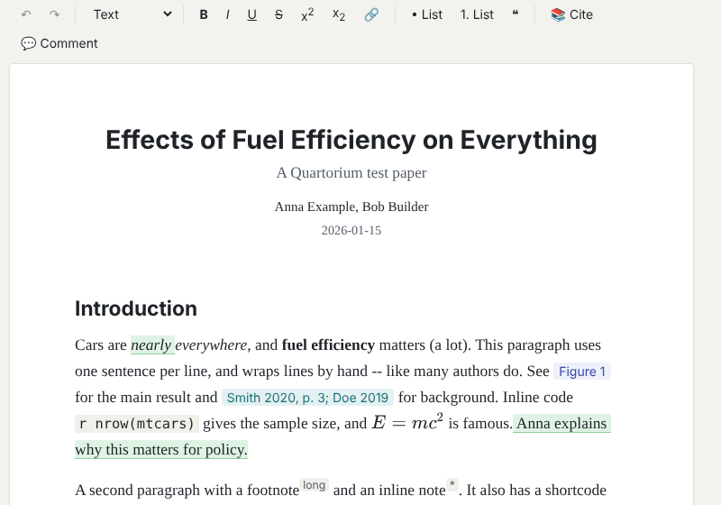
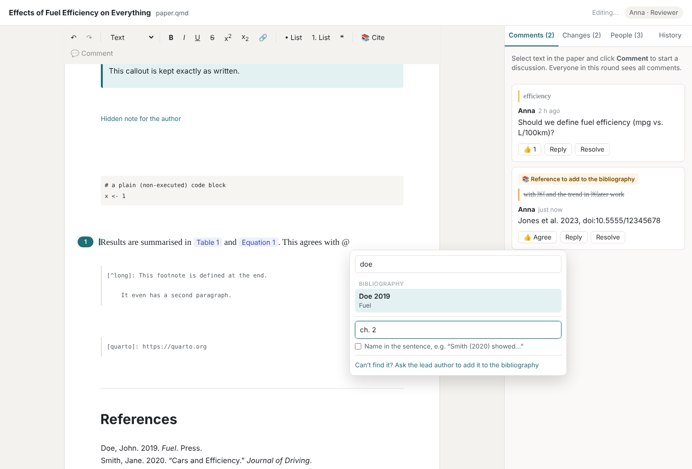
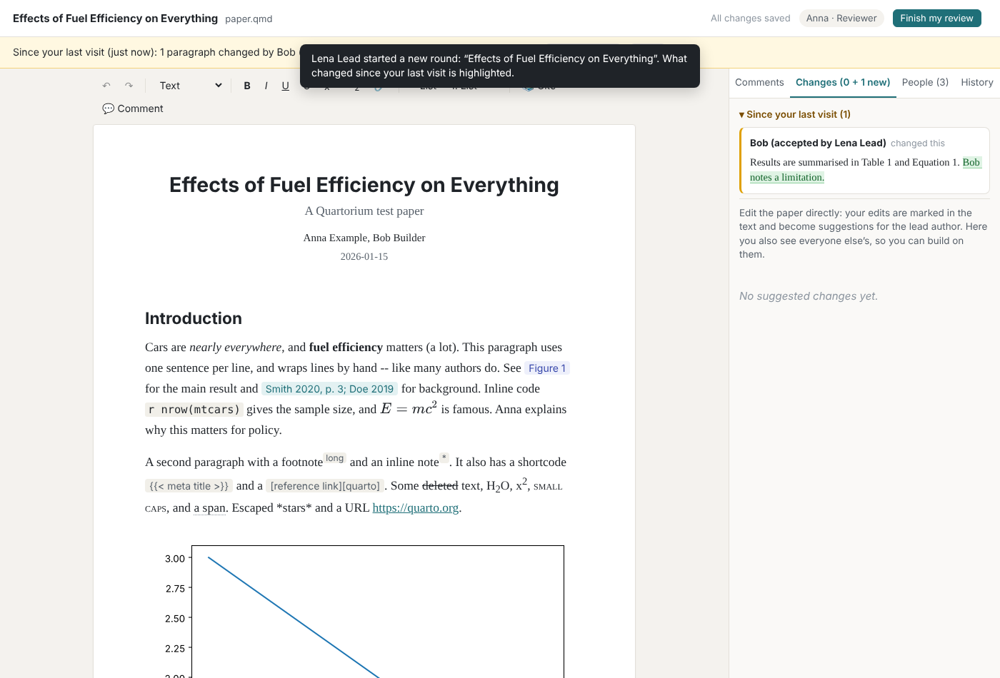
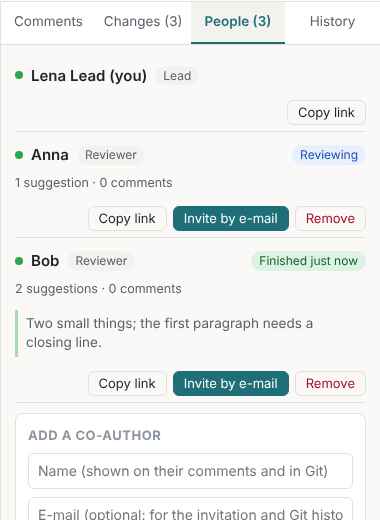
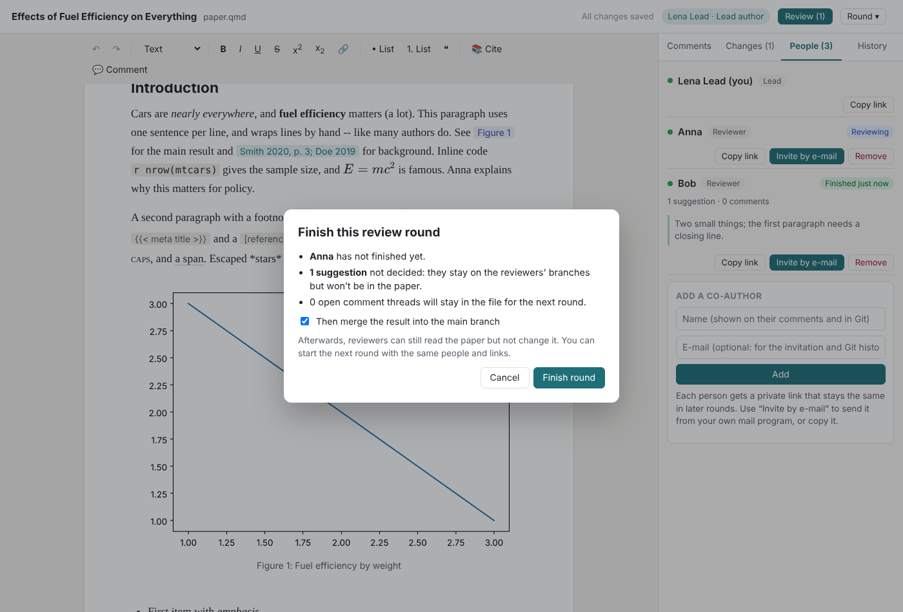
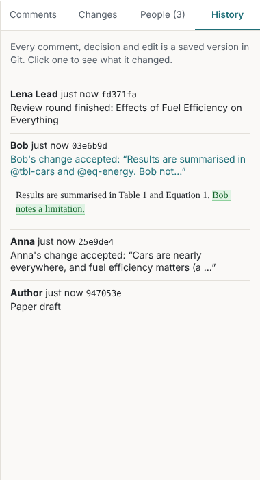

There are two roles. **Reviewers** (co-authors) read, edit and comment. The **lead author**
does the same, decides which suggestions go into the paper, and runs the rounds. A round can
have more than one lead.

## For reviewers

### Open your link

Your link opens the paper as it will look: headings, figures, tables, equations and
references. There is nothing to install and no account. The link is personal; please don't
forward it.

The same link keeps working in later rounds and always opens the current version.

### Edit the text

Click anywhere in the text and type, as in Word. Your edits are saved within a second or two
(*All changes saved* at the top) and marked in the text: new words are highlighted in green,
removed words are struck through.

::: {.screenshot}

:::

Your edits are *suggestions*. Everyone in the round can see them under **Changes**, and the
lead author accepts or rejects them. You can see everyone else's suggestions too, so if
someone already rewrote a paragraph you can build on their version or comment on it instead
of rewriting it again.

Some parts of the paper are *locked*: code and its output (figures, tables), equations, the
title block, and a few special blocks. Hover over one to see why; **Show source** shows what
is behind it. If something there needs changing, leave a comment.

### Comment

Select some text and click **Comment** (in the toolbar or the small menu above the
selection). Everyone sees all comments. You can reply, and **👍 Agree** with someone else's
comment instead of writing the same thing again. The author of a comment, or the lead, can
resolve it.

### Cite

Type `@` at the start of a word, or click **📚 Cite**. Search by author, title or year, or
pick a figure, table, equation or section of the paper. You can add a page or chapter, and
choose *Name in the sentence* for "Smith (2020) showed…".

::: {.screenshot}

:::

If the reference isn't in the paper's bibliography, click **Can't find it?** and paste a DOI,
a link or the full reference. This leaves a note at that spot for the lead author, who adds
it to the bibliography; after that, anyone can cite it.

### Finish your review

When you're done, click **Finish my review** at the top. You can add a note for the lead
author, like the e-mail you would send with a Word file. Everything is already saved; this
tells the lead you are done and records your review in the paper's history. You can still
make changes afterwards.

### When you come back

If the paper changed since your last visit, a yellow banner tells you how many paragraphs
changed and by whom. The paragraphs are marked in the margin, and **Changes → Since your
last visit** shows each change word by word. Click one to see it in place.

::: {.screenshot}

:::

## For lead authors

### Invite people

In **People**, add each co-author's name (and optionally an e-mail address). **Invite by
e-mail** opens your own mail program with a ready-made message, or the server sends it if mail
is configured. You can also copy the link and send it any way you like.

The People tab shows where everyone is: *Not opened yet*, *Reviewing*, or *Finished*, with
their note, and how many suggestions and comments each person made.

::: {.screenshot}

:::

### Go through the suggestions

Your own edits go straight into the paper. Co-authors' edits arrive as suggestions, one per
paragraph. Click **Review** at the top to go through every suggestion and comment in
document order. Each suggestion is shown in place: removed words struck through, new words in
green.

| Key | In the review queue |
|---|---|
| A | Accept the suggestion |
| R | Reject the suggestion (or resolve the comment) |
| N / → | Next |
| P / ← | Previous |
| 1–9 | Switch between competing versions of a paragraph |
| Esc | Close the queue |

If two people rewrote the same paragraph, both versions are shown together and you pick one.
Once you accept one, the other is marked *outdated*: it can no longer be applied
automatically, so nothing is overwritten by accident. You can still copy from it, then
dismiss it.

For many small edits, **Changes → Accept all that don't conflict** (or *All from Anna*)
accepts everything that doesn't compete with another version.

Accepted text is committed with the co-author as its Git author, so `git blame` credits the
person who wrote each sentence.

### Keep working in your own editor

You can keep working in RStudio or VS Code during a round: change code, add figures, edit
text. Pull at the start of a session, then commit, pull and push as usual. Quartorium takes
your pushes into the round within a minute, and puts accepted text and comments on main, so
your next pull brings them. **Round ▾ → Sync with main now** does both at once.

Edits to different paragraphs never get in each other's way. If you changed the same
paragraph as the round, your version is kept and the other one is attached as a comment.
See [Working in RStudio during a round](git.qmd#working-in-rstudio-during-a-round).

### Finish the round

Choose **Round ▾ → Finish round…**. The dialog shows who hasn't finished and how many
suggestions are undecided.

::: {.screenshot}

:::

Finishing a round:

- makes the paper read-only for reviewers;
- removes resolved comment threads from the file (they stay in the history) and keeps open
  ones for the next round;
- leaves undecided suggestions on the reviewers' branches, out of the paper;
- puts the result on main (or offers to, if main isn't kept up to date).

### Main is kept up to date

By default, everything that is committed in the round (accepted suggestions, your edits,
comments) is put on main automatically, so main is always the latest agreed version of the
paper. If your main branch is protected, or you prefer to merge yourself, turn off
**Round ▾ → Keep main up to date**. Then use **Round ▾ → Merge into main**, or a pull request
from the branch `quartorium/…`. See [Main stays up to date](git.qmd#main).

### Start the next round

**Round ▾ → Start next round…** starts a new round with the same people and **the same
links**. It starts from main (or from the finished round, if that isn't on main). Everyone sees what changed since their last visit. Earlier rounds stay available
read-only under **Round ▾ → Earlier rounds**.

### The history

**History** lists every saved version: comments, accepted and declined suggestions, finished
reviews and rounds, with who did what. Click an entry to see what it changed, word by word.

::: {.screenshot}

:::

## Supported Quarto features {#supported}

Quartorium opens any `.qmd` file. Whatever the editor can't change is shown as a *locked*
block with its rendered output, so a document never comes up blank. Co-authors comment on
locked blocks instead of editing them.

- **Editable:** paragraphs, headings (labels such as `{#sec-intro}` are kept), bullet and numbered lists (also nested), block quotes, horizontal rules. Bold, italic, strikethrough, underline, superscript, subscript, small caps, links, spans with attributes, line breaks. New citations and cross-references from the paper's bibliography and labels.
- **Shown as chips in the text** (they can be moved or deleted, not edited): citations and cross-references (as "Smith et al. 2020", "Figure 1"), inline math, inline code such as `` `r nrow(df)` ``, inline shortcodes such as `{}`, footnotes (`^[…]`, `[^1]`), inline images, raw inline HTML or LaTeX.
- **Shown, locked:** the YAML header (as a title block), code chunks (as their output: figures, tables, printed results; the code under *Show source*), plain code blocks, tables with their captions, display equations, callouts and every other `:::` block (figure and layout divs, panels, `{#refs}`), raw LaTeX/HTML blocks, shortcodes on their own line (`{}`, `{}`), footnote definitions, HTML comments and blocks, definition lists, line blocks.
- **Not supported:** editing more than one file per round (included files are shown, not edited), Jupyter notebooks (`.ipynb`) and R Markdown (`.Rmd`) as the reviewed file, interactive widgets (htmlwidgets, Observable, Shiny; their static output is shown), live cursors (others' work appears within about ten seconds).

Figures, tables and cross-reference numbers come from a real `quarto render` on the server,
so the server needs what your code needs (R, Python, packages) unless your project uses
Quarto's [`freeze`](https://quarto.org/docs/projects/code-execution.html#freeze) and commits
`_freeze/`. If rendering fails, locked blocks show their source, and the lead sees Quarto's
error message.

How each of these is stored and written back is explained in
[How .qmd files are changed](qmd-files.qmd).
