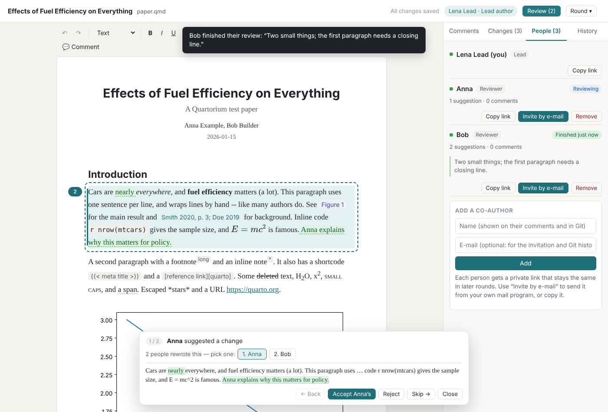

::: hero
::: lead
Write your paper in Quarto. Your co-authors review it in the browser, the way they would
review a Word file, without installing anything or learning Git.
:::
Every edit, comment and decision ends up in your Git repository, attributed to the person
who made it.
:::

## Why

Quarto papers are reproducible: text, code, figures and references live together in plain
text, under version control. Most co-authors, though, are used to receiving a Word document
in track-changes mode, and asking them to use Git, RStudio or Markdown is a non-starter.
So papers get converted to Word, comments come back in five different files, and the
reproducible source drifts away from the version that was actually reviewed.

Quartorium closes that gap. The author keeps working in Quarto and Git. Co-authors get a
link, read the paper with its real figures and tables, and edit and comment as they would
in Word. Everything flows back into the same repository as ordinary commits.

## What it does

::: feature-grid
::: feature
#### Receive a link and just work
No accounts and no software. Each person has a private link that stays the same in later
rounds. Edits are saved as you type.
:::
::: feature
#### Parallel, transparent review
Everyone edits at the same time. Each person's edits are shown to everyone as suggestions,
so people build on each other instead of repeating work.
:::
::: feature
#### Track changes, but faster
Insertions and deletions are marked in the text. The lead goes through a review queue with
the keyboard: accept, reject, next. Competing rewrites of a paragraph are shown side by side.
:::
::: feature
#### The real paper
Figures, tables and equations come from a real `quarto render`. Citations and
cross-references read "Smith et al. 2020" and "Figure 1". Co-authors can cite from the
paper's bibliography.
:::
::: feature
#### Your source stays yours
Untouched text keeps its exact bytes. Code, data and the YAML header can't be changed from
the browser. A one-word edit is a one-line Git diff.
:::
::: feature
#### A complete paper trail
Comments, accepted and declined changes, and finished reviews are Git commits by the people
who made them, on any Git host: Codeberg/Forgejo, GitLab, GitHub or your own server.
:::
:::

## A review round at a glance

::: {.steps}
1. **You write** in RStudio or VS Code and push, as usual.
2. **Start a round** on a `.qmd` from the admin page.
3. **Send the links** to your co-authors, or let Quartorium e-mail them.
4. **Everyone works in parallel.** Edits become suggestions that everyone can see.
5. **Reviewers finish** with a note, like sending back the Word file.
6. **You decide** in the review queue: accept, reject, next.
7. **Finish the round** and merge it into main.
8. **Next round:** the same people, with the same links.
:::

::: {.screenshot}

:::

## Where to go next

- **[Getting started](getting-started.qmd)**: install, connect a repository, start your first round.
- **[User guide](guide.qmd)**: what reviewers and lead authors do, step by step.
- **[Git and the paper trail](git.qmd)**: branches, what is committed when, and merging into main.
- **[How .qmd files are changed](qmd-files.qmd)**: exactly what happens to your source.
- **[Architecture](architecture.qmd)**: components, data flow and the API, for contributors.
- **[Security and privacy](security.qmd)**: links, code execution and where data lives.
